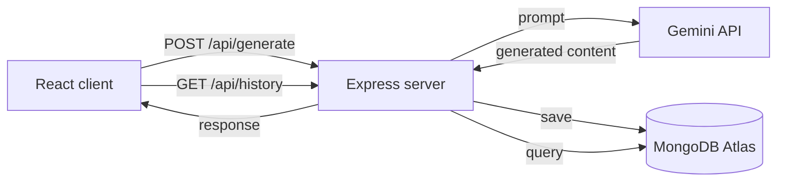

<div align="center">

# CreatorFlow AI

**A content studio for YouTube creators.**
Enter a topic and get a script, title, description, thumbnail prompt, tags and spin-off ideas in one pass.

[](https://creator-flow-ai-youtube-tool.vercel.app)


[Live Demo](https://creator-flow-ai-youtube-tool.vercel.app) · [Report a Bug](https://github.com/mandeeproy999999-commits/CreatorFlow-AI/issues) · [Request a Feature](https://github.com/mandeeproy999999-commits/CreatorFlow-AI/issues)

</div>

---

## Overview

Planning a video usually means juggling five different tabs: one for the script, one for title research, one for tags, one for thumbnail ideas, and a notes app for everything else. CreatorFlow AI collapses that into a single form.

You describe the video (topic, audience, tone, category) and the app uses Google Gemini to produce a complete, publish-ready content package. Every generation is saved, so you can come back to earlier ideas later.

## What You Get

Each generation returns:

| Output | Details |
| --- | --- |
| **Video script** | A 2 to 3 minute script, written for the tone and audience you pick |
| **SEO title** | A search-friendly title built around your topic |
| **Description** | A ready-to-paste YouTube description |
| **Thumbnail prompt** | A text prompt you can feed to any image generator |
| **Tags and keywords** | Relevant tags and SEO keywords for the video |
| **Alternative ideas** | Related video concepts for your next upload |

Along with that:

- Generation history stored in MongoDB Atlas
- One-click copy on every output block
- Responsive layout that works on desktop and mobile

## How It Works



1. The client sends the topic, audience, tone and category to the Express API.
2. The server builds a structured prompt and calls the Gemini API.
3. The result is saved to MongoDB and returned to the client.
4. The history view reads past generations back from the database.

## Tech Stack

| Layer | Technology |
| --- | --- |
| Frontend | React, JavaScript, Axios, CSS3 |
| Backend | Node.js, Express.js |
| Database | MongoDB Atlas, Mongoose |
| AI | Google Gemini API |
| Deployment | Vercel |

## Project Structure

```
CreatorFlow-AI/
├── client/
│   ├── public/
│   └── src/
│       ├── components/
│       ├── services/
│       ├── App.jsx
│       └── main.jsx
├── server/
│   ├── config/
│   ├── controllers/
│   ├── models/
│   ├── routes/
│   ├── services/
│   └── server.js
└── README.md
```

## Getting Started

### Prerequisites

- Node.js 18 or later
- A MongoDB Atlas cluster and connection string
- A Google Gemini API key from [Google AI Studio](https://aistudio.google.com/)

### 1. Clone the repository

```bash
git clone https://github.com/mandeeproy999999-commits/CreatorFlow-AI.git
cd CreatorFlow-AI
```

### 2. Set up the backend

```bash
cd server
npm install
```

Create a `.env` file inside `server/`:

```env
PORT=5000
MONGO_URI=your_mongodb_connection_string
GEMINI_API_KEY=your_gemini_api_key
```

Start the server:

```bash
npm run dev
```

### 3. Set up the frontend

In a second terminal:

```bash
cd client
npm install
npm run dev
```

The app will be available at the local URL printed by Vite, and the API at `http://localhost:5000`.

### Environment Variables

| Variable | Description |
| --- | --- |
| `PORT` | Port the Express server listens on |
| `MONGO_URI` | MongoDB Atlas connection string |
| `GEMINI_API_KEY` | API key for Google Gemini |

Never commit your `.env` file. Make sure it is listed in `.gitignore`.

## API Reference

### `POST /api/generate`

Generates a full content package for a video topic.

**Request body**

```json
{
  "topic": "French Revolution",
  "audience": "General",
  "tone": "Educational",
  "category": "History"
}
```

| Field | Type | Description |
| --- | --- | --- |
| `topic` | string | What the video is about |
| `audience` | string | Who the video is for |
| `tone` | string | Style of the script, such as Educational |
| `category` | string | Content category, such as History |

### `GET /api/history`

Returns previously generated content stored in the database.

## Roadmap

- [ ] User authentication
- [ ] Export scripts as PDF
- [ ] Download generated content
- [ ] Favorites and saved projects
- [ ] Search and filter for history
- [ ] Multi-language script generation
- [ ] AI image generation for thumbnails
- [ ] Reusable content templates


## Contributing

Contributions are welcome. If you have an idea or found a bug:

1. Fork the repository
2. Create a branch: `git checkout -b feature/your-feature`
3. Commit your changes: `git commit -m "Add your feature"`
4. Push the branch: `git push origin feature/your-feature`
5. Open a pull request

## Support

If CreatorFlow AI is useful to you, a star on the repository helps others find it.
