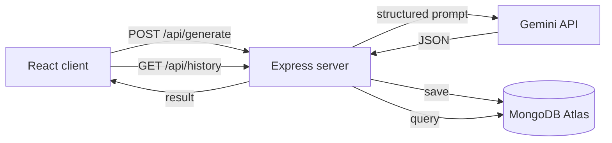

<div align="center">

# CreatorFlow AI

**An AI content studio for YouTube creators.**
Enter a topic and get a hook, script, title, description, thumbnail prompt, tags and spin-off video ideas in one click.

[](https://creator-flow-ai-youtube-tool.vercel.app)


[Live Demo](https://creator-flow-ai-youtube-tool.vercel.app) · [Report a Bug](https://github.com/mandeeproy999999-commits/CreatorFlow-AI/issues)

</div>

---

## Overview

Planning a single video usually means juggling a script doc, a title brainstorm, a tag list and a thumbnail idea in separate places. CreatorFlow AI puts all of that behind one form.

You pick a topic, an audience and a tone. The server sends a structured prompt to Google Gemini, saves the result to MongoDB, and the React client displays it as copyable sections.

## What Each Generation Contains

| Output | Details |
| --- | --- |
| Title | A clickable, SEO-optimized video title |
| Hook | An opening line designed for the first 15 seconds |
| Script | A script of roughly 2 to 3 minutes |
| Description | An SEO-optimized YouTube description |
| Thumbnail prompt | A detailed prompt for any AI image generator |
| Tags | 10 tags |
| SEO keywords | 10 keywords, saved with each generation |
| Alternative ideas | 5 related video ideas |

The form lets you choose:

- **Audience:** General, Students, Professionals, Kids
- **Tone:** Educational, Storytelling, Funny, Motivational

Every generation is stored in MongoDB and listed in a history sidebar. Each text section has a one-click copy button.

## How It Works



1. The form sends `topic`, `audience` and `tone` to `POST /api/generate`.
2. The route hands the request to a controller, which calls the Gemini service.
3. The service builds the prompt, calls `gemini-2.5-flash`, strips any markdown fences and parses the JSON.
4. The controller saves the result to MongoDB and returns it to the client.
5. The client renders the result and refreshes the history list.

## Tech Stack

| Layer | Technology |
| --- | --- |
| Frontend | React 19, Vite, Axios, CSS |
| Backend | Node.js, Express 5 |
| Database | MongoDB Atlas, Mongoose |
| AI | Google Gemini API (`@google/genai`) |
| Hosting | Vercel (client and server deployed as separate projects) |

## Project Structure

```
CreatorFlow-AI/
├── client/
│   └── src/
│       ├── components/
│       │   ├── GenerateForm.jsx
│       │   ├── OutputCard.jsx
│       │   ├── SectionCard.jsx
│       │   ├── CopyButton.jsx
│       │   ├── HistorySidebar.jsx
│       │   └── HistoryItem.jsx
│       ├── services/
│       │   └── api.js
│       ├── App.jsx
│       └── main.jsx
└── server/
    ├── config/
    │   └── db.js
    ├── controllers/
    │   ├── generateController.js
    │   └── historyController.js
    ├── models/
    │   └── History.js
    ├── prompts/
    │   └── youtubePrompt.js
    ├── routes/
    │   ├── generateRoutes.js
    │   └── historyRoutes.js
    ├── services/
    │   └── geminiService.js
    ├── server.js
    └── vercel.json
```

## Getting Started

### Prerequisites

- Node.js 20.19 or later
- A MongoDB Atlas cluster and its connection string
- A Gemini API key from [Google AI Studio](https://aistudio.google.com/)

### 1. Clone the repository

```bash
git clone https://github.com/mandeeproy999999-commits/CreatorFlow-AI.git
cd CreatorFlow-AI
```

### 2. Run the server

```bash
cd server
npm install
```

Create `server/.env`:

```env
PORT=5000
MONGO_URI=your_mongodb_connection_string
GEMINI_API_KEY=your_gemini_api_key
```

Start it:

```bash
npm run dev
```

The API is now running at `http://localhost:5000`.

### 3. Run the client

In a second terminal:

```bash
cd client
npm install
npm run dev
```

The client calls the API through the base URL set in `client/src/services/api.js`. It points at the deployed backend by default. To use your local server instead, change it to:

```js
baseURL: "http://localhost:5000/api"
```

### Environment Variables

| Variable | Description |
| --- | --- |
| `PORT` | Port for the Express server (defaults to 5000) |
| `MONGO_URI` | MongoDB Atlas connection string |
| `GEMINI_API_KEY` | Google Gemini API key |

Never commit your `.env` file.

## API Reference

### `POST /api/generate`

Generates a content package and saves it to history.

```json
{
  "topic": "French Revolution",
  "audience": "General",
  "tone": "Educational"
}
```

The response is a JSON object with these keys:

```json
{
  "title": "",
  "hook": "",
  "script": "",
  "description": "",
  "thumbnailPrompt": "",
  "tags": [],
  "seoKeywords": [],
  "alternativeIdeas": []
}
```

### History

| Method | Endpoint | Description |
| --- | --- | --- |
| `GET` | `/api/history` | List all generations, newest first |
| `GET` | `/api/history/:id` | Get a single generation |
| `DELETE` | `/api/history/:id` | Delete a generation |

## Roadmap

- [ ] User authentication
- [ ] Open a past generation from the history sidebar
- [ ] Display SEO keywords in the output
- [ ] Export scripts as PDF
- [ ] Multi-language script generation
- [ ] AI image generation for thumbnails
- [ ] Reusable content templates

## Contributing

Contributions are welcome.

1. Fork the repository
2. Create a branch: `git checkout -b feature/your-feature`
3. Commit your changes: `git commit -m "Add your feature"`
4. Push the branch: `git push origin feature/your-feature`
5. Open a pull request
